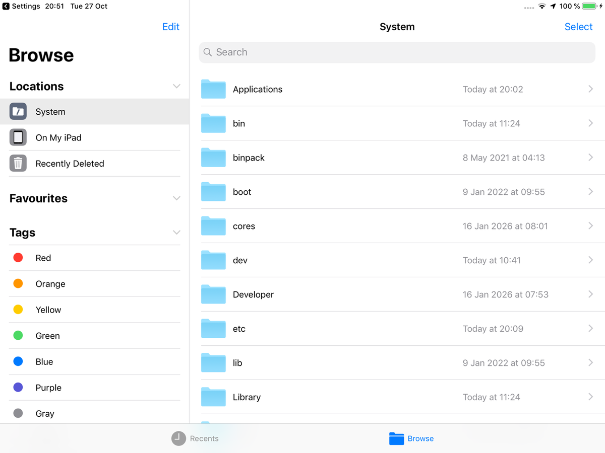
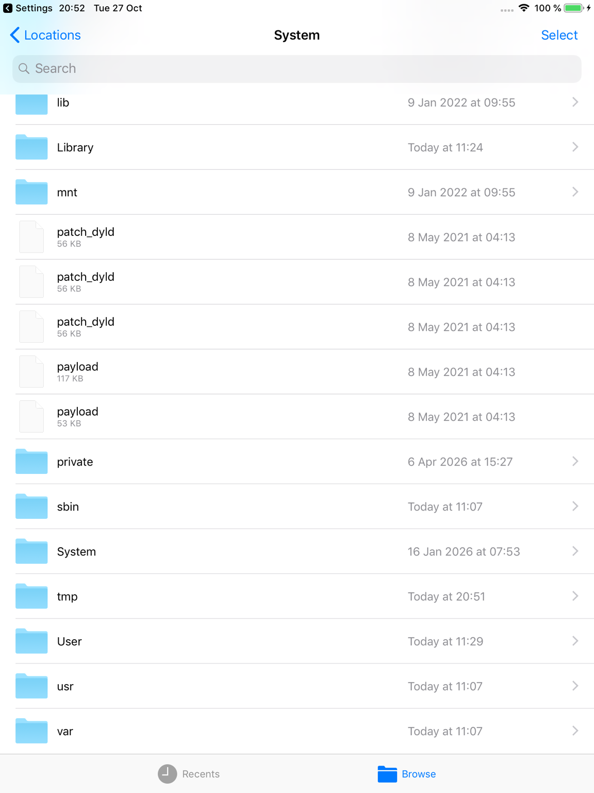
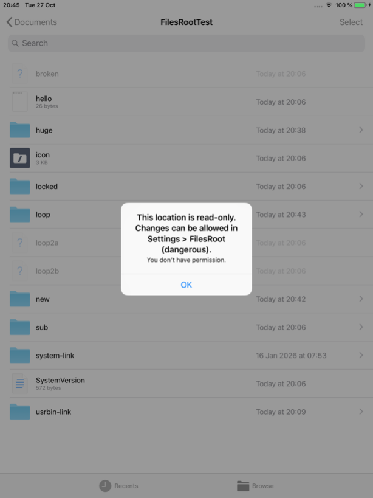
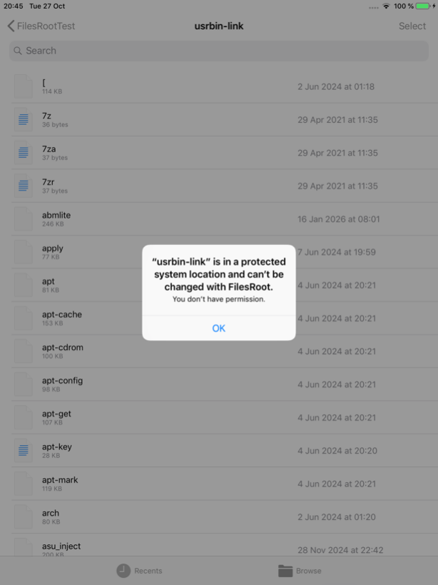
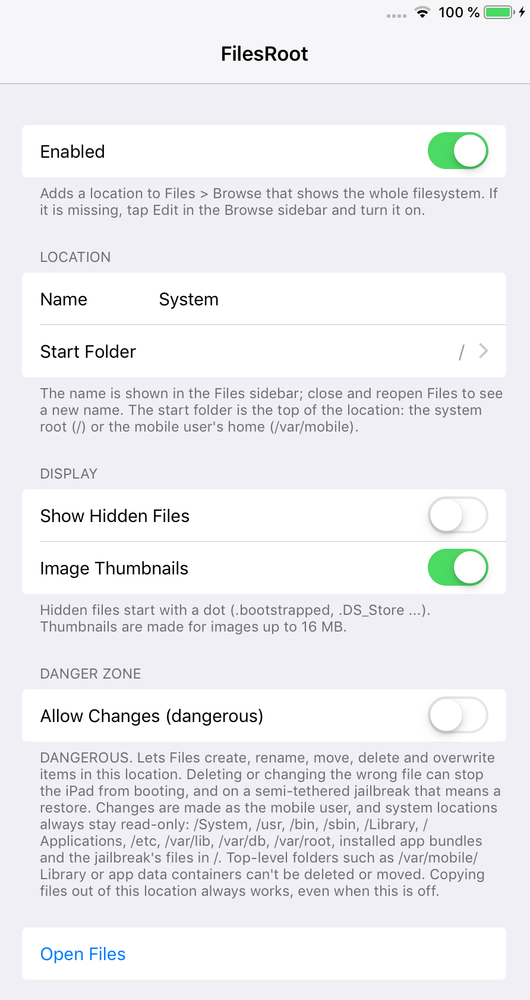

<p align="center"></p>

<h1 align="center">FilesRoot (iOS 12)</h1>

**Browse the whole filesystem of your jailbroken device in the Files app.**

The Files app on iOS 12 only shows On My iPad, iCloud Drive and the folders that apps share. FilesRoot adds a **System** location to the Files sidebar that starts at `/`, the root of the filesystem. You can look around in it, preview files with Quick Look, copy files out to On My iPad, and open or share them with other apps, all without a separate file manager.

**It is read-only by default.** You can allow changes in Settings, but system folders always stay protected (see [Safety](#safety)).

This is an unofficial jailbreak tweak. It is not affiliated with or endorsed by Apple.

## Screenshots

The System location in the Files sidebar:



| Browsing `/` | Read-only by default |
| --- | --- |
|  |  FilesRoot (dangerous)." width="380"> |

System folders stay protected even with changes allowed (here `/usr/bin`, reached through a link):



Settings > FilesRoot:



## Features

- **A "System" location in Files** that shows the whole filesystem, starting at `/` or, if you prefer, at `/var/mobile`. The name can be changed in Settings.
- **Preview** files with Quick Look, **copy** them (or whole folders) to On My iPad or another location, and **share** or open them in other apps.
- **Image thumbnails**, made with strict memory limits so that big or unusual images can't crash the location.
- **Hidden files** (names starting with a dot) on request.
- Works in the Files app and in the Files picker ("Open" and "Save to Files") that other apps show.
- **Read-only by default.** Optional, clearly marked "Allow Changes (dangerous)" switch for creating, renaming, moving, deleting and editing items, with a permanent list of protected system locations.
- Settings apply right away. No respring needed.

## Safety

FilesRoot gives the Files app access to every folder on the device. Read this before you turn on **Allow Changes**.

**With Allow Changes off (the default), FilesRoot never changes anything.** Every write operation is refused, and Files doesn't even offer Delete, Rename or Move in this location. Copying files *out* of the location always works.

**With Allow Changes on**, you can create, rename, move, delete and overwrite items. Deleting or changing the wrong file can stop the device from booting, and on a semi-tethered jailbreak such as checkra1n that can mean a restore. So:

- **Deleting is permanent.** This location has no Recently Deleted, so there is no undo.
- **Protected locations stay read-only, always:** `/System`, `/usr`, `/bin`, `/sbin`, `/Library`, `/Applications`, `/private/etc` (`/etc`), `/private/var/lib` (dpkg and apt), `/private/var/db`, `/private/var/root`, installed app bundles, keychains, the jailbreak's own files in `/` (such as `/.bootstrapped` and `/.procursus_strapped`), `/binpack`, `/dev` and a few more system folders. See the list in [`shared/FRPolicy.c`](shared/FRPolicy.c).
- **The layout can't be broken:** top-level folders such as `/var/mobile`, `/var/mobile/Library`, `/var/mobile/Documents`, the folders directly inside them, and app data containers can't be deleted, renamed or moved. Nothing can be created directly in `/`, `/private` or `/private/var`.
- **Links can't be used to get around this.** Every path is resolved before it is checked, so `/var/../System`, `/etc` (a link to `/private/etc`) or a link that you made to `/usr/bin` lead to the protected location and are refused. Deleting a link removes only the link, never what it points to.
- **Hard-linked files are never overwritten,** because the other name could be in a protected folder.
- **FilesRoot works as the `mobile` user, not as root.** Even outside the protected list, the system itself refuses changes to files that belong to root. Files that only root can read are shown greyed out and can't be opened.
- Every change is checked twice: Files only offers the actions that are allowed, and the extension checks again before it touches the disk.
- Copying a whole folder out stops at 20,000 items, 4 GB or 64 levels deep, and when less than 200 MB would be left free.

The rules are plain C in [`shared/FRPolicy.c`](shared/FRPolicy.c) and have unit tests in [`tests/policy_test.c`](tests/policy_test.c).

If something goes wrong, turn off **Allow Changes** (or **Enabled**) in Settings > FilesRoot, or uninstall the package. Uninstalling removes the location and leaves your files as they are.

## Compatibility

- Tested on an iPad mini 2 with iOS 12.5.8, jailbroken with checkra1n + odysseyra1n (Procursus, libhooker).
- Expected to work on iOS 12.x. It should work on iPhone too, but it has only been tested on iPad.
- Works alongside [FilesArchiver](https://github.com/itsAllexB/FilesArchiver-iOS12) (Uncompress and Compress in the System location follow the same rules) and [FilesExtensions](https://github.com/itsAllexB/FilesExtensions-iOS12) (shows the full file names, which matters for system files).

## Install

Add the **iOS Legacy** source to your package manager, then search for FilesRoot:

```
https://itsallexb.github.io/ios-legacy/
```

One tap on your device: [Add to Sileo](https://itsallexb.github.io/ios-legacy/add/sileo.html) · [Add to Zebra](https://itsallexb.github.io/ios-legacy/add/zebra.html) · [Add to Cydia](https://itsallexb.github.io/ios-legacy/add/cydia.html)

Or download the `.deb` from [Releases](https://github.com/itsAllexB/FilesRoot-iOS12/releases/latest) and install it with Filza or `dpkg -i`.

Then open Files > Browse. If **System** isn't listed under Locations, tap **Edit** in the Browse sidebar and turn it on.

Requires `mobilesubstrate` (Substrate, Substitute or libhooker) and PreferenceLoader. Your package manager installs them automatically.

## Settings

Open **Settings > FilesRoot**:

- **Enabled**: shows or hides the location in Files.
- **Name**: the name in the Files sidebar (default "System"). Close and reopen Files to see a new name.
- **Start Folder**: the top of the location, either the system root `/` (default) or the mobile user's home `/var/mobile`.
- **Show Hidden Files** (off by default): shows names that start with a dot, such as `.bootstrapped`.
- **Image Thumbnails** (on by default): makes thumbnails for images. JPEGs up to 4 megapixels and other images up to 1 megapixel get one; larger images show a plain icon.
- **Allow Changes (dangerous)** (off by default): lets Files create, rename, move, delete and overwrite items in this location, except in protected locations. Read [Safety](#safety) first.
- **Open Files**: opens the Files app.

## Known limits

- The location shows what the `mobile` user may read. Folders and files that only root can read appear greyed out or empty.
- Opened and copied files are kept as a copy (an instant clone where possible, so it costs no extra space) in FilesRoot's own storage, and removed when Files no longer needs them, or after a day.

## Build from source

You need [Theos](https://theos.dev/docs/installation) and an iOS SDK (the Makefile uses the iOS 14.5 SDK and targets iOS 12.0, arm64).

```sh
git clone https://github.com/itsAllexB/FilesRoot-iOS12.git
cd FilesRoot-iOS12
make package FINALPACKAGE=1
```

The package is written to `packages/`. To install it on a device over SSH, set `THEOS_DEVICE_IP` and run `make install`.

The policy tests run on a Mac:

```sh
cd tests
cc -I../shared ../shared/FRPolicy.c policy_test.c -o policy_test && ./policy_test
```

What's in this repo:

- `provider/`: the File Provider extension (`FilesRootProvider.appex`) that Files talks to. It lists folders, hands out copies of files for previews and sharing, makes thumbnails, and carries out changes when they are allowed. The comments at the top of [`provider/FRProvider.h`](provider/FRProvider.h) explain how identifiers and storage work.
- `shared/FRPolicy.c`: the write rules (protected and structural paths, link resolution, hard links). Plain C, so it can be tested on a Mac.
- `app/`: a tiny host app, hidden from the Home Screen. iOS only loads File Provider extensions from inside an app. If it is ever opened, it explains where the location is.
- `ui/Tweak.x`: a small tweak for Files and the Files picker that applies the location name and the Enabled switch, which a File Provider extension can't control itself.
- `prefs/`, `layout/`: the Settings page and the install scripts (they register the hidden app and restart `fileproviderd`).
- `tests/policy_test.c`: unit tests for `FRPolicy.c`.

## Credits and license

Made by [itsAllexB](https://github.com/itsAllexB).

FilesRoot is free software under the GNU General Public License v3.0 or later. See [LICENSE](LICENSE).

iPad, iPhone and Files are trademarks of Apple Inc. This project is not affiliated with Apple.
